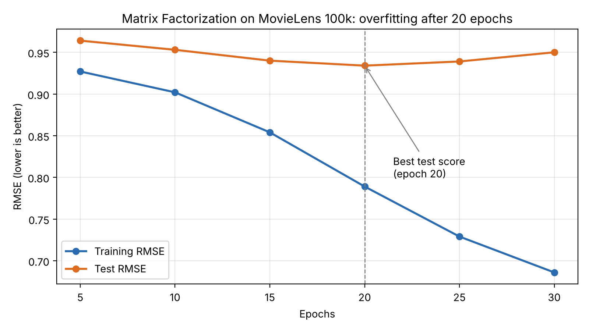
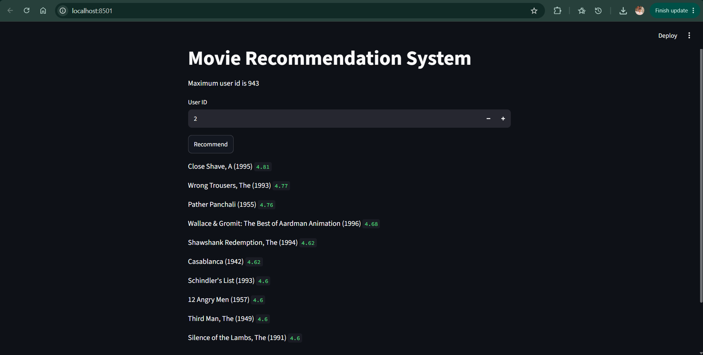

# Movie Recommendation System (Matrix Factorization)

A collaborative filtering recommender built from scratch with NumPy. It learns hidden "taste" factors for users and movies from past ratings, then predicts what a user would rate movies they haven't seen. A Streamlit app shows the top 10 recommendations for any user.

## Dataset

[MovieLens 100k](https://grouplens.org/datasets/movielens/100k/)

- 943 users, 1,682 movies, 100,000 ratings (scale 1-5)
- Only about 6% of the user-movie matrix is filled, so most ratings must be predicted
- Train/test split: the dataset's own `ua.base` (90,570 ratings) and `ua.test` (9,430 ratings)

## Approach

Matrix factorization with bias terms, trained by stochastic gradient descent (SGD).

Prediction for user *u* and movie *i*:

```
rating = global average + user bias + movie bias + (user factors . movie factors)
```

- **Latent factors:** each user and each movie gets a vector of 20 numbers, learned from the data
- **Bias terms:** capture generous vs harsh raters and universally loved vs disliked movies
- **Loss:** squared error plus an L2 regularization penalty to reduce overfitting
- **Training:** SGD over every training rating, repeated for several epochs

| Setting | Value |
|---|---|
| Latent factors | 20 |
| Learning rate | 0.01 |
| Regularization | 0.02 |
| Epochs | 20 (chosen from the experiment below) |
| Initial factor values | small random numbers (0 to 0.1) |

## Experiments

I trained for 30 epochs and measured test RMSE every 5 epochs to find where the model stops improving.

| Epochs | Training RMSE | Test RMSE |
|---|---|---|
| 5 | about 0.93 | 0.964 |
| 10 | about 0.90 | 0.953 |
| 15 | about 0.85 | 0.940 |
| **20** | **about 0.79** | **0.934** |
| 25 | about 0.73 | 0.939 |
| 30 | about 0.69 | 0.950 |



An earlier run with only 3 epochs gave a test RMSE of 0.972.

Training error keeps falling, but test error is lowest at about 20 epochs and then rises. After that point the model memorizes the training ratings instead of learning general taste, which is overfitting. I stopped at 20 epochs (early stopping).

Note: the epoch count was chosen by looking at the test score. This is a mild form of tuning on the test set, so the final number is slightly optimistic. A separate validation split would be the cleaner approach (see Future Work).

## Results

| Metric | Value |
|---|---|
| Test RMSE (3 epochs, first run) | 0.972 |
| Test RMSE (20 epochs, final model) | 0.934 |

The exact value changes slightly in the third decimal between runs because the starting factors are random. Always predicting the global average rating gives a noticeably higher error (about 1.1 on this dataset), so the model has learned real patterns.

## App Screenshot



## Observations

Top-10 lists for different users still overlap. With the final model, user 1 and user 2 share 4 of 10 movies (Casablanca, A Close Shave, Pather Panchali, The Third Man). With the earlier 3-epoch model they shared 5 of 10, and user 1 and user 43 shared 7 of 10. Recommendations lean toward well-known, highly rated classics, which points to movie bias carrying much of the prediction. More training made the lists a little more varied, but I only compared a few users, so this is a suggestion and not proof of better personalization.

## Limitations

- **Cold start:** a new user or a new movie with no ratings has no learned vectors, so the model cannot score it
- **Popularity bias:** broadly loved movies rank high for many users
- **Predictions are not clipped to 1-5 during training.** Some raw predictions exceed 5, so the app caps the displayed rating at 5. Ranking is done on the raw values
- **Hyperparameters:** only the number of epochs was tuned; learning rate, regularization, and number of factors were not
- **Ratings only:** genres, user demographics, and timestamps are not used

## Future Work

- Hold out a validation split for tuning, and keep the test set for the final score
- Tune the learning rate, regularization strength, and number of factors
- Clip predictions to 1-5 and check the effect on RMSE
- Add a popularity fallback for cold-start users
- Vectorize training for speed (the current loop uses `iterrows`)

## Project Structure

```
project-3/
├── ml-100k/               # MovieLens dataset (download separately, not in the repo)
├── modul.py               # training + evaluation, saves the model
├── app.py                 # Streamlit app
├── user_factor.pkl        # saved user factor matrix (943 x 20)
├── movie_factor.pkl       # saved movie factor matrix (1682 x 20)
├── user_bias.pkl          # saved user biases
├── movie_bias.pkl         # saved movie biases
├── gobel_rating.pkl       # saved global average rating
├── requirements.txt       # dependencies
├── screenshot.png         # app screenshot used in this README
├── overfitting_curve.png  # training vs test RMSE chart used in this README
├── .gitignore             # ignores the dataset folder and Python cache files
└── README.md
```

## Files

| File | Purpose |
|---|---|
| `modul.py` | Loads data, trains the model, evaluates on the test set, saves the model files |
| `app.py` | Streamlit app that loads the saved model and shows top-10 recommendations |
| `*.pkl` | Saved model: user and movie factors, user and movie biases, global average |
| `requirements.txt` | Python dependencies |

The final model (20 epochs) was trained in Google Colab with the same code as `modul.py`, and the `.pkl` files were downloaded from there.

## How to Run

1. Download MovieLens 100k and extract it into a folder named `ml-100k` in the project directory
2. Install the dependencies:

```
pip install -r requirements.txt
```

3. (Optional) Retrain the model. Set the number of epochs in `modul.py` first. This takes a few minutes and overwrites the `.pkl` files:

```
python modul.py
```

4. Start the app:

```
streamlit run app.py
```

Choose a user ID (1-943), click **Recommend**, and the top 10 unseen movies appear with their predicted ratings.

## Tech Stack

Python, NumPy, pandas, joblib, Streamlit
